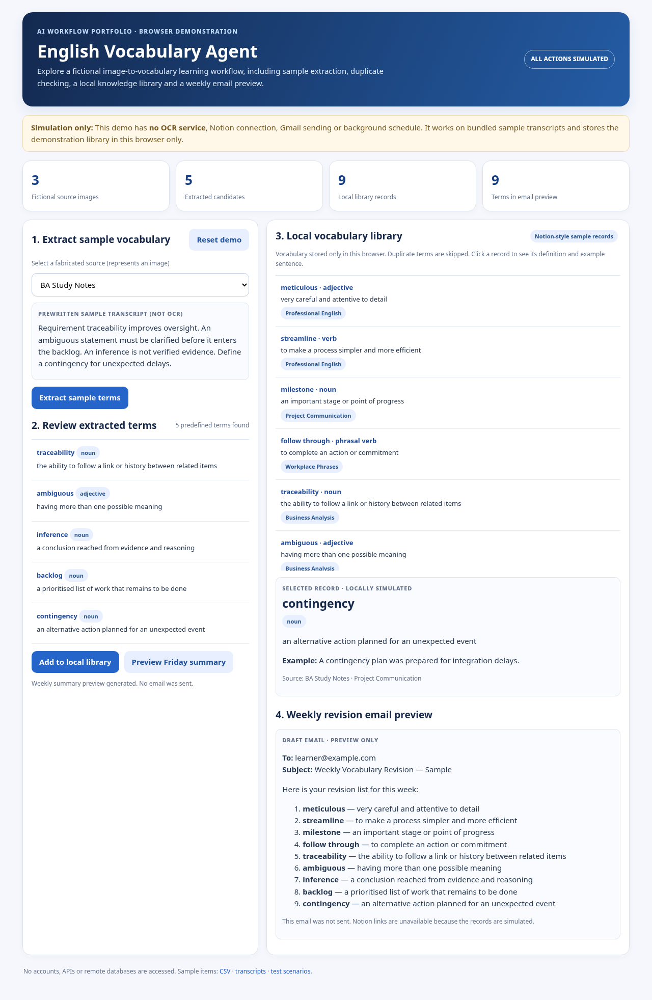
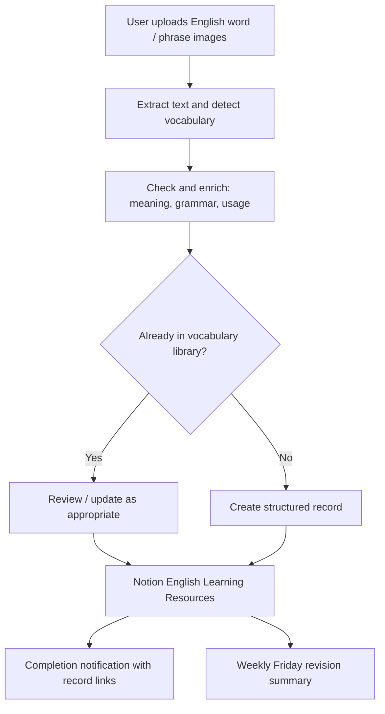

# English Vocabulary Agent — AI Workflow Portfolio Demo

> **Public portfolio with fictional sample data.** This project documents an image-to-vocabulary learning workflow originally explored using ChatGPT, Google Drive, Notion and Gmail. The published HTML demo is **not connected** to those services and sends **no email**.

## What problem does it address?

Vocabulary collected from screenshots and images can be difficult to organise and revise consistently. The intended workflow reduces repeated manual transcription by extracting candidate English words and phrases, creating structured learning records, and preparing notifications and review material.

## Try the interactive demonstration

Open `index.html` locally, or enable GitHub Pages for the repository.

1. Select one of three **fictional image transcripts**.
2. Click **Extract sample terms** (fixed predefined matching; not actual OCR).
3. Click **Add to local library** (Notion-style simulation using browser local storage).
4. Repeat with another sample; duplicate terms are skipped.
5. Click **Preview Friday summary** (email content preview; **not sent**).
6. Use **Reset demo** to clear stored sample records.

## Intended agent workflow

The original ChatGPT Project concept included:

- Reusable image-based vocabulary and phrase extraction, including multiple terms within a single image.
- Explanations and example sentences prepared for learning.
- Structured updates to an existing Notion learning-resource page.
- A proposed daily Google Drive folder check for new images.
- A proposed email notification with links after updates and a separate Friday revision email.

The live status and reliability of external integrations are **not demonstrated or independently verified** by this public repository. Scheduled automation, Notion updates and Gmail sending are outside the included demo.

## Files

| File | Purpose |
|---|---|
| `index.html` | Interactive self-contained browser simulation |
| `sample_vocabulary.csv` / `.json` | 12 completely invented learning entries |
| `SAMPLE_IMAGE_TRANSCRIPTS.md` | Three fabricated source texts, standing in for images |
| `CHATGPT_AGENT_INSTRUCTIONS.md` | Generic agent/project instructions to adapt privately |
| `WORKFLOW_AND_DATA_MODEL.md` | Suggested Notion schema, integrations and failure handling |
| `TEST_CASES.md` | Manual test scenarios and expected results |

## Business analysis and automation skills demonstrated

Process modelling, input/output data mapping, duplicate handling, validation rules, exception paths, output templates, data integrity, and end-to-end test case design. ChatGPT assisted with documentation and the public demonstration implementation; the business goal and workflow requirements were specified and reviewed by the project owner.

## Publication / safety

All transcripts, vocabulary records and source references are **fictional**. There are no real email addresses, Notion page IDs, OAuth tokens, user screenshots or personal data. Never put secrets into a public GitHub repository.
